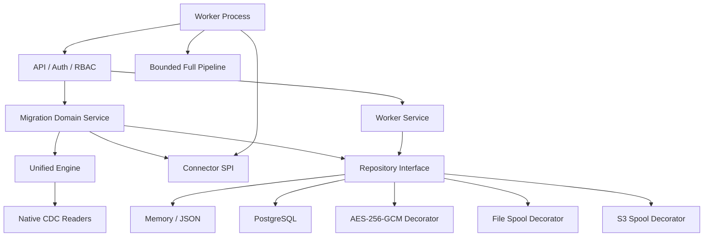
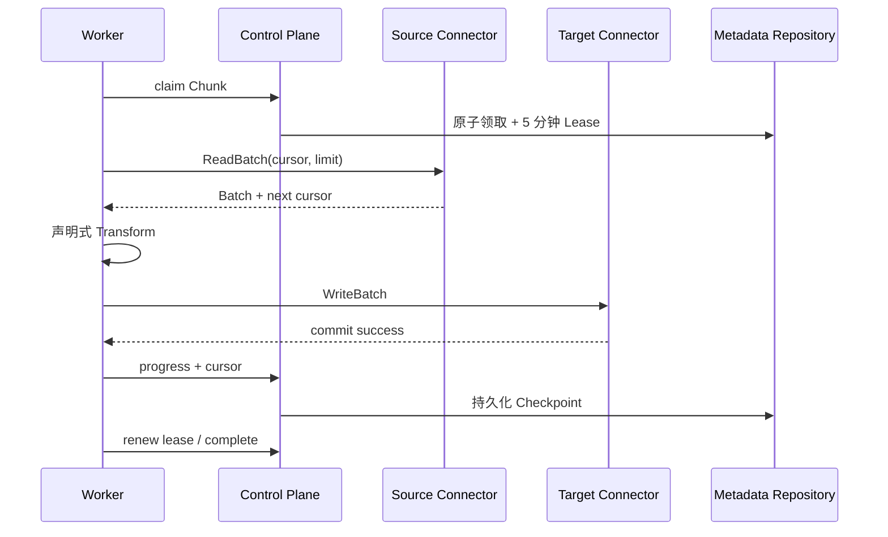
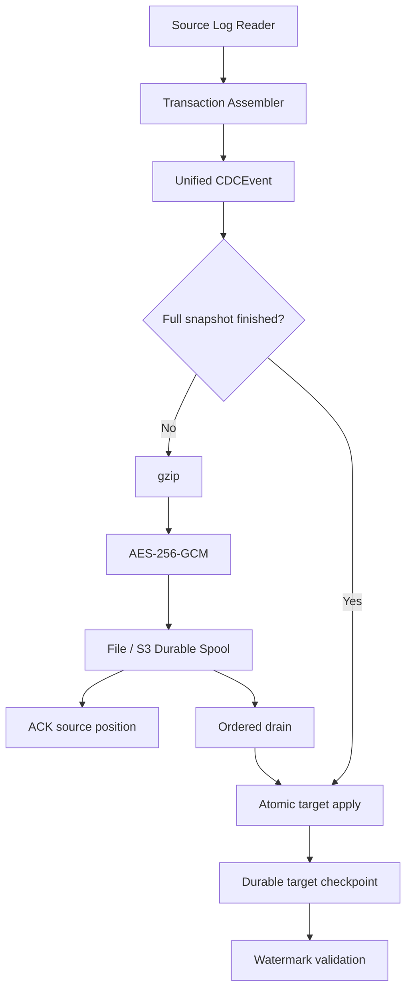

# DTS 项目架构文档

文档基线为 `0.15.0-rc50`。

分析日期：2026-09-02  
事实来源：当前仓库代码、部署清单和自动化脚本；历史 Release Notes 仅作参考。

## 1. 系统定位

DTS 是统一数据库迁移平台，不是多个第三方迁移程序的启动器。用户只配置源端、目标端、迁移对象和策略；运行时固定使用 DTS Unified Engine。

系统覆盖以下迁移生命周期：

1. 数据源管理与能力探测；
2. 迁移前检查和兼容性评估；
3. Schema/表规划；
4. 分片全量迁移；
5. 增量 CDC 捕获与回放；
6. 数据校验、验收报告和归档；
7. 割接、反向 CDC 和回切；
8. 监控、告警、审计和 Worker 调度。

## 2. 系统上下文

```mermaid
flowchart LR
    User[管理员 / DBA / Operator] --> Web[Vue 3 Console]
    Automation[自动化 / dtsctl] --> API[Go Control Plane API]
    Web --> API
    Prom[Prometheus] --> Metrics[/metrics]
    API --> Meta[(PostgreSQL Metadata)]
    API --> Spool[(Encrypted CDC Spool)]
    API --> Workers[Distributed Workers]
    Workers --> Source[(Source Database)]
    Workers --> Target[(Target Database)]
    Workers --> API
    API --> Archive[(S3 / WORM Report Archive)]
```

Web 和 CLI 属于管理面；Server 负责生命周期、策略和持久化；Worker 执行全量 Chunk 和被托管的 CDC Reader；源库与目标库属于数据面边界。

## 3. 运行时组件

| 组件 | 代码位置 | 主要职责 |
|---|---|---|
| Web Console | `web/src` | Vue 3 + Element Plus 管理界面，轮询和 WebSocket 实时状态 |
| HTTP API | `backend/internal/api` | REST、WebSocket、认证授权、审计、Prometheus 指标 |
| Migration Service | `backend/internal/migration` | 状态机、Precheck、规划、调度、校验、CDC、割接和回切 |
| Unified Engine | `backend/internal/engine` | 固定执行引擎；按源端协议选择 DTS 自有 CDC Reader |
| Connector SPI | `backend/internal/connector` | 数据库能力描述、元数据、读写、DDL、CDC、拓扑、压力采样 |
| Full Pipeline | `backend/internal/pipeline` | Reader → 有界队列 → Transform → Writer → Checkpoint |
| CDC Runtime | `backend/internal/cdc` | 各厂商日志读取、解码、事务组装和统一事件模型 |
| Worker | `backend/cmd/worker` | 注册、心跳、领取/续租 Chunk、运行 CDC 子进程、上报进度 |
| Repository | `backend/internal/repository` | Memory/PostgreSQL 元数据实现，以及安全、File/S3 Spool 装饰器 |
| Validation Report | `backend/internal/validationreport` | JSON/HTML/PDF、哈希、Ed25519、TSA、S3/WORM 归档 |
| Maintenance | `backend/internal/maintenance` | 元数据保留策略和周期清理 |
| CLI | `backend/cmd/dtsctl` | 任务操作、报告验签和 Trust Store 生命周期 |

## 4. 前端架构

前端采用 Vue 3、Vue Router、Element Plus、TypeScript 和 Vite。页面按业务域划分：

- 首页：资源总览；
- 数据源：连接配置、测试、Schema 对象查看；
- 迁移任务：创建、执行、详情、Chunk、CDC、DLQ、冲突、报告；
- 校验中心、割接中心、监控中心；
- Worker、告警、审计、用户与权限、访问设置。

`web/src/api/client.ts` 使用同源会话 Cookie 访问 API、下载 Blob 和连接 WebSocket。Server 签发 HttpOnly Cookie 并校验浏览器写请求和 WebSocket 的来源。Nginx 在生产镜像中托管静态资源并将 `/api/`、`/metrics` 代理到 Server。

当前前端仍是轻量管理台：业务状态主要留在各 Vue 页面内，Pinia 虽已安装但未承担统一会话、权限和任务状态管理。

## 5. 后端分层与依赖方向



主要依赖方向基本合理：API 调用领域服务，领域服务依赖 SPI/Repository，具体数据库实现位于基础设施层。需要注意的是 `migration.Service` 已同时承担过多应用服务职责，详见架构评估文档。

## 6. 全量迁移数据流



关键不变量：

- Reader 只允许有限预取，有界 Channel 提供自然反压；
- 目标写入成功后才提交 Cursor；
- 崩溃可能重放未确认批次，但不能跳过数据；
- Chunk 支持 Range、Bounded Keyset、Hash、Partition 和 Custom SQL；
- Worker Lease 过期后工作可由其他 Worker 领取；
- 控制面可根据数据库压力、Worker 负载和吞吐目标调整 Batch 与有效并行度。

## 7. Full + CDC 数据流



Spool 将 Full Snapshot 的耗时与源端日志保留窗口解耦。默认 File Spool 使用 `fsync + atomic rename`，S3 模式在应用层先加密后上传。目标 Apply 成功后才推进目标 Checkpoint；Spool 水位进入 CRITICAL 时停止确认源端，形成安全反压。

## 8. 生命周期状态机

主要路径如下：

```text
CREATED
  → PRECHECKING → PRECHECK_SUCCESS → PREPARING
  → [CDC_INITIALIZING]
  → FULL_MIGRATING → FULL_FINISHED
  → [CDC_CATCHING_UP]
  → [VALIDATING]
  → READY_FOR_CUTOVER → CUTOVER_RUNNING → FINISHED
  → [ROLLBACK_PREPARING → ROLLBACK_SYNCING → ROLLBACK_READY
     → ROLLBACK_RUNNING → ROLLED_BACK]
```

`PAUSED`、`FAILED`、`CANCELLED` 是旁路状态。状态转换由 `internal/migration/state_machine.go` 显式约束。

Server 为 Precheck、Validation、Cutover 和 Rollback 写入带 TTL 的 `control_operation_leases` 并持续续租，File/S3 和加密包装层均保留租约能力。启动后每 30 秒巡检中断状态：Precheck 可安全重放，Validation 会清理本轮不完整结果后重跑；Prepare 一旦可能修改目标对象便不自动重放，租约过期后失败关闭并要求人工核查。最终割接/回切的 RUNNING 状态中断后同样失败关闭；尚未拆为持久 Saga，也未实现完整的跨 Server 数据面 fencing，详见[企业就绪度复查](ENTERPRISE_READINESS.md)。

CDC 直接/托管 Apply、Spool 排空、死信处置、进度上报和校验屏障还共享按任务、方向划分的 `cdc_spool_drain_leases`。每次执行使用独立 Owner 并续期，COMMIT 与 Checkpoint 前检查租约；直接 Apply 先处理历史 Spool，未解决死信阻止后续事务越过。该协调依赖所有 Server 使用同一版本，不等同于目标库提交的原子 fencing。

## 9. 数据与持久化

### 9.1 元数据

生产模式使用 PostgreSQL，保存：

- 数据源、用户、迁移任务、表和 Chunk；
- Worker、Engine Job、Lease、Checkpoint；
- Server 控制面 Operation Lease；
- CDC Position、Spool Index、DLQ、冲突记录；
- 校验结果、不可变 Validation Archive、报告归档登记；
- 告警、审计和任务日志。

开发模式可使用内存或持久化 JSON 文件。Memory/JSON 不适合多 Server 或生产规模。

### 9.2 敏感数据

`secure.Repository` 使用 AES-256-GCM 加密数据源密码、TLS 私钥、CDC DLQ/Spool 载荷。密钥由 `DTS_MASTER_KEY` 经 SHA-256 派生。丢失 Master Key 后相关密文不可恢复，因此它必须独立备份并由 Secret Manager 托管。

### 9.3 Schema 版本

Server 和手工升级脚本共用幂等 `schema.sql`。每个 Server 通过有界连接池访问元数据库，事务独占连接直至提交或回滚。`/readyz` 会比较 `metadata_schema_state.schema_version` 与二进制版本，当前期望值为 `0.15.0-rc50`。

## 10. Connector 能力边界

能力通过 Descriptor 显式声明，任务启动时按 Full Read、Full Write、CDC Read、Transactional Apply 等能力失败关闭，不会静默回退到第三方迁移引擎。

| 数据库族 | 默认能力状态 | 备注 |
|---|---|---|
| MySQL、MariaDB、PolarDB MySQL、PolarDB-X | Native Full + CDC | 具体版本、权限和日志格式由 Precheck 校验 |
| PostgreSQL、PolarDB PostgreSQL | Native Full + pgoutput CDC | 依赖 replication slot / logical replication |
| TiDB | Experimental Full + TiCDC | 需要真实 TiCDC/Kafka 资格验证 |
| OceanBase MySQL | Experimental Full + Binlog Service CDC | SQL 与 CDC Endpoint 分离 |
| openGauss、Kingbase | 默认 Native Full Only | CDC 需显式实验开关和资格验证 |
| GaussDB | 默认仅 Probe | Full/CDC 均由独立实验开关控制 |
| Oracle、SQL Server、DB2、达梦 | 默认仅 Probe | 数据面已存在实验实现，生产使用必须通过资格验证 |
| GBase 8a、GBase 8s | 默认仅 Probe | 依赖实验开关；8s/达梦还依赖厂商驱动 Provider |

运行时应以 `GET /api/v1/connectors` 返回的 Descriptor 为准，不应只根据数据库名称推断支持度。

## 11. 部署拓扑

### 运行底座

多节点使用 Kubernetes/containerd 执行 Pod。Server、Worker、Web 通过 Deployment 和 Service 管理，元数据及 Spool 使用持久存储。单机可以使用独立的 Docker Compose 离线包，其中包含 Docker Engine、Compose v2 和所需镜像。

### Kubernetes 示例

默认包含两个 Server、三个 Worker、两个 Web、HPA、三组 PDB 和共享 RWX Spool PVC。应用副本使用 hostname Topology Spread 和 Pod Anti-Affinity 跨节点分散；副本数和 HPA 上限可由安装器调整。清单不内嵌运行 Secret，临时 DaemonSet 会在部署前验证每个可调度节点的离线镜像。内置 `postgres.yaml` 仅用于测试/小规模环境，生产多节点通过安装器接入外部 HA PostgreSQL，并使用外部 Secret、不可变 Digest、NetworkPolicy 和可信 Ingress/TLS。

多 Server 的 File Spool 必须共享同一个 RWX 文件系统；也可以使用 S3-Compatible Spool。PostgreSQL 中的 Drain Lease 用于避免多 Server 同时回放同一方向。

## 12. 对外接口

- 管理 REST：`/api/v1/*`；
- 实时事件：`/api/v1/ws`；
- Worker 内部接口：`POST /api/v1/workers/*`；
- Liveness：`/healthz`；
- Readiness：`/readyz`；
- Prometheus：`/metrics`。

API 覆盖数据源、迁移、校验报告、CDC、DLQ、割接、Worker、用户、告警和审计。[OpenAPI 3.1 接口规范](openapi.json) 列出了 HTTP 路由、请求和响应类型、鉴权方式与状态码。修改接口后，在 `backend` 目录运行 `go run ./cmd/openapi-gen` 重新生成规范，运行 `go run ./cmd/openapi-gen -check` 检查与当前代码是否一致。

API 响应通过 `X-Request-ID` 返回请求关联号。客户端传入 1–96 个字母、数字、点、下划线或连字符时沿用该值。JSON 错误包含 `error`、`code` 和 `request_id`，服务日志可按同一关联号查询。

开发开放模式下，空用户库只允许首次登记一个已启用的管理员。多个请求同时创建首个账号时，只有一个请求会成功。各 Server 副本在放行开放模式请求及 WebSocket 推送前核对共享用户库，发现首次登记后即要求身份认证。启用 `DTS_AUTH_REQUIRED` 的部署需提前配置引导管理员或有效的静态凭据。

登录会话登记在共享元数据库。用户可以在“访问设置”查看和撤销自己的会话，管理员可在“用户与权限 → 编辑”管理指定用户的会话。退出登录会撤销当前会话。后续 HTTP 请求和 WebSocket 推送会重新检查撤销状态。身份库暂时不可用时，API 返回 503，事件流稍后重连，恢复后仍可使用未过期的原会话。旧版本签发的有效会话在首次请求时自动登记，登记前不会出现在列表中。机器 Token 仍通过部署配置管理。

升级时所有 Server 须切换到同一版本。使用外部迁移的实例需要按顺序执行 `084_v015_rc50_user_sessions.sql` 和 `085_v015_rc50_personal_tokens.sql`，包括元数据版本字段已经是 RC50 的实例。启用自动迁移的部署在启动时创建两张登记表。恢复备份可能恢复早期撤销状态，恢复后应更换各副本共同使用的 `DTS_AUTH_SECRET`，使历史登录会话和个人 API 令牌失效。

登录后可在“访问设置 → 我的 API 令牌”签发或撤销本人使用的命令行凭据。API 客户端用有效的用户会话向 `POST /api/v1/auth/personal-tokens` 提交 `name` 和 RFC 3339 格式的 `expires_at`。名称最多 80 个字符，截止时间须在未来 365 天内，每个账号可保有 100 个有效令牌。创建响应的 `token` 只出现一次，客户端以 `Authorization: Bearer <token>` 访问业务 API。其他两个入口为 `GET /api/v1/auth/personal-tokens` 和 `DELETE /api/v1/auth/personal-tokens/{token_id}`。

Server 按请求读取账号当前角色和有效期。账号禁用或修改密码时同步删除其个人令牌，重新启用账号需重新签发。个人令牌只支持 HTTP Bearer，WebSocket、Worker 内部接口和个人凭据管理均使用各自的认证方式。`DTS_OIDC_ONLY=true` 时个人令牌签发与认证均关闭。普通登录会话退出后，已签发的个人令牌可用至主动撤销、账号失效或截止时间。

企业 OIDC 登录支持单一 HTTPS Issuer 的授权码流程，使用 PKCE S256、state、nonce 和远端 JWKS 验签。在所有 Server 副本设置相同的 `DTS_OIDC_ISSUER`、`DTS_OIDC_CLIENT_ID`、`DTS_OIDC_REDIRECT_URL` 和至少 32 字节的 `DTS_AUTH_SECRET`。机密客户端还需通过 Secret 设置 `DTS_OIDC_CLIENT_SECRET`。在身份提供方登记完整 HTTPS 回调地址，路径为 `/api/v1/auth/oidc/callback`。绑定配置 `DTS_OIDC_BINDINGS` 的示例为 `{"https://id.example.org":{"external-subject":"usr_123"}}`，其中值是 DTS 已有用户的不可变 ID。登录后沿用本地角色、禁用状态和会话撤销机制。更改绑定并重启所有副本后，每次使用已有企业会话都将重新核对绑定。

设置 `DTS_OIDC_ONLY=true` 可强制用户使用企业登录，包括切换前签发的密码会话和静态用户 Token 都会被拒绝。独立 Worker 密钥仍用于节点通信。部署前应完成至少一个本地管理员的外部身份绑定。可将 `DTS_OIDC_REQUIRED_ACR` 设置为身份提供方定义的 MFA 保证级别，服务在授权时请求该值并校验签名 ID token 中的 `acr`。LDAP 对接或 MFA 验证器由身份提供方配置。

## 13. 安全模型

- 账号密码登录签发有时效的 Session Token；
- 静态 RBAC Token 适合自动化；
- 角色为 Admin、DBA、Operator、Viewer；
- Worker 使用独立 `X-DTS-Worker-Token`；
- 数据源 TLS 支持 DISABLE、PREFERRED、REQUIRED 和双向证书字段；
- API 可直接 TLS 或由可信代理终止 TLS；
- 数据源凭据与 CDC 载荷静态加密；
- 审计记录包含 Actor、Action、资源和 Remote Address；
- 验收报告支持 SHA-256、Ed25519、公钥轮换/撤销、RFC3161 TSA 和 S3/WORM。

安全默认值和待补能力见[架构评估与缺失功能](ARCHITECTURE_ASSESSMENT.md)。
