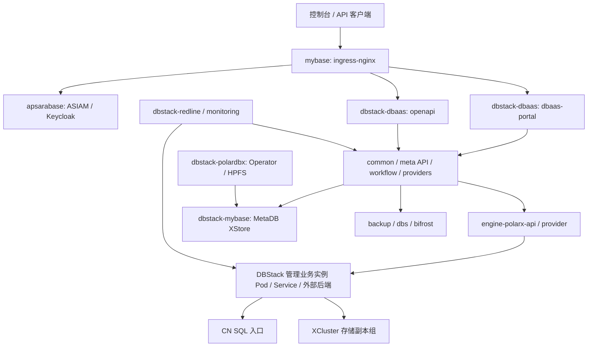

# 10.10.156.111 现场架构与 API

调查日期：2026-09-14，入口 `root@10.10.156.111`，主机 `gk1`。证据来自 Kubernetes 清单、工作负载探针、Service/Ingress/EndpointSlice、已安装 PolarDB-X SDK 及只读连接探测。未更改数据库和集群配置。

## 部署结构

| 节点 | 内网地址 | 角色 |
|---|---|---|
| gk1 | 10.10.156.111 | control-plane/master |
| gk2 | 10.10.156.112 | control-plane/master |
| gk3 | 10.10.156.113 | control-plane/master |
| gk4 | 10.10.156.106 | worker |
| gk5 | 10.10.156.109 | worker |
| px1 | 10.10.156.115 | worker |
| px2 | 10.10.156.114 | worker |
| px3 | 10.10.156.116 | worker |
| sj4 | 10.10.156.241 | worker |
| sj5 | 10.10.156.239 | worker |

10 个节点均为麒麟 V10，内核 `4.19.90-89.11.v2401.ky10.x86_64`；Kubernetes `v1.30.3`，Docker `27.1.2`。调查时节点均 Ready。gk1–gk5 allocatable CPU 为 30 核、内存约 59.8 GiB；px1–px3 / sj4–sj5 为 30 核、约 44.0 GiB。



图中的服务调用分层依据组件命名、入口和部署职责整理；并非通过分布式链路追踪确认的全部逐跳调用关系。

| 命名空间 | 主要组件与职责 |
|---|---|
| apsarabase | ASIAM、Keycloak：身份与认证 |
| dbstack-dbaas | Portal、OpenAPI、meta-api、workflow-engine、polarx API/provider、备份/资源管理、业务数据库 Pod |
| dbstack-mybase | `metadb-default`：平台元数据库 XStore，3 个副本分布 gk1/gk2/gk3 |
| dbstack-polardbx | controller-manager 3 副本、clinic、HPFS、tools-updater |
| dbstack-redline | Redline master/worker、polaralert、Alertmanager：监控与告警 |
| dbstack-dashboard | headlamp |
| mybase | ingress-nginx、external-dns |
| monitoring | kube-state-metrics；不据此假设存在 Prometheus HTTP API |
| kube-system / kube-flannel | Kubernetes 控制面、DNS、metrics-server、网络 |

**管理路径差异：**现场 `PolarDBXCluster` 清单为空；`XStore` 只有平台 MetaDB。业务实例没有标准 PolarDBXCluster CR，主要通过 DBStack 标签发现。业务存储镜像为 `apsaradb-alios7u-mysql_xcluster80:20260712-20260728170054`；可见旧 CN 镜像为 `polardbx-sql:5.4.20-20260708_17835008-private-x86`。不能直接套用“只检查 polardbxcluster CR”的开源版巡检。

标准 PolarDB-X 中 CN 负责分布式 SQL，DN 负责存储与多数派复制，GMS 负责元数据与授时，CDC 提供日志服务。这里只把它作为逻辑架构背景；现场 GMS/CDC 与各组 Pod 的完整业务映射仍需业务 API 认证清单核对。[PolarDB-X 官方架构](https://www.alibabacloud.com/help/zh/polardb/polardb-for-xscale/architecture-6)

## 业务实例入口与实测边界

| 实例 | externalIP / NodePort | 现场后端 |
|---|---|---|
| pxc-xxrn1szq4dqgbb | 10.10.156.106:35009 | gk4:3000；存在可见 CN Pod |
| pxc-xxr5a44mk8kh4q | 10.10.156.116、10.10.156.109:34549 | px3:3002、gk5:3000 |
| pxc-xxrrbqd25knyni | 10.10.156.116、10.10.156.239:37991 | px3:3009、sj5:3001 |

后两个实例在调查时有 Service/EndpointSlice，但没有对应可见 CN Pod，所列后端连接被拒绝。报告按“从 gk1 无法连接”记录；是否正在创建、迁移或其他运行模式，尚未取得认证 API 证据，不做假定。

共发现 8 个 XCluster 存储副本组和 1 个可见 CN Pod 组；其中 `pxc-xdb-s-xxr5a44mk8kh4q5073` 有 2 个 Pod，其余存储组各 3 个。该 2-Pod 组从 gk1 握手返回 MySQL 1130（来源地址不允许），因此不把它记为数据库已停机。

平台 MetaDB `metadb-default` 为 Running、3/3；引擎 `8.0.41-X-Cluster-8.4.20-20250916`，调查时 Leader 在 gk1。MetaDB 不等同于业务实例内部的 GMS。

gk1 `/` 为约 391 GiB 的 XFS，`/apsara` 为约 1.2 TiB 的独立 XFS，`/var/lib/docker` 位于该数据盘。仅检查根分区不能代替所有数据盘巡检。

## 平台入口与健康接口

以下 ClusterIP 是发现时快照，程序优先动态解析当前清单。

| 接口 | 入口 | 成功语义 |
|---|---|---|
| Kubernetes | `kubectl get --raw /readyz` | `ok`，复用 kubeconfig |
| DBStack OpenAPI | `openapi.dbstack-dbaas.svc:80/common/healthCheck`，当时 172.24.235.254 | JSON `Code:200` |
| DBStack Portal | `dbaas-portal.dbstack-dbaas.svc:80/common/healthCheck`，当时 172.24.154.211 | JSON `code:"200"`、`successResponse:true` |
| PolarX API | Pod:9171 `/healthCheck/check` | 来自部署 readiness/liveness 探针 |
| OpenAPI Ingress | Host `openapi.dbstack.test.com`，节点 HTTP 80 | 同 OpenAPI 健康 JSON |
| Portal Ingress | Host `dbstack-console.test.com`，节点 HTTP 80 | 308 至同域名 HTTPS 健康路径；Service 健康另行验证 |
| 节点资源 | `/api/v1/nodes/{name}/proxy/stats/summary` | kubelet CPU、memory、fs、imageFs、volume |

OpenAPI Service NodePort 为 35871；Portal 为 36308；Portal Health 为 35582。业务数据库 NodePort 见前表。内部 `rdsapi-polarx` Service 为 21150，不能把它与 Pod 健康探针端口 9171 混淆。

现场某 meta-api readiness 指向 `/api/v1.0/accesskeys?requestId=livenessProbe`；尽管它被当作探针，可能返回敏感信息，巡检程序明确不调用。仅允许已知健康路径，并忽略带自定义 HTTP headers 的自动探针。

## PolarDB-X OpenAPI 协议

现场参考源：

```text
/usr/local/rds/openapi/sdk/polarx/main.dara
/usr/local/rds/openapi/sdk/polarx/openApiSDK-polarx-go/client/client.go
/usr/local/rds/openapi/sdk/polarx/dbstack-polarx-1.3.0-202608201920.jar
```

从 `main.dara` 提取 169 个 GET RPC Action，完整目录在 `api-catalog.json`。该目录不包含凭据、业务表数据或 SDK 私有实现全文。

普通区域模式的读取协议：根路径 `/`，`Action`、`Format=json`、`OpenApiVersion=v1`、`ServiceCode=polardbx`、`Timestamp`、`SignatureNonce`；请求头 `x-acs-version:v1` 和 `x-acs-action`。认证字段为 `AccessKeyId`、`SignatureMethod=HMAC-SHA1`、`SignatureVersion=1.0`、`Signature`。按 RFC3986 排序编码参数，签名串为 `GET&%2F&percentEncode(canonicalQuery)`，HMAC key 为 `AccessKeySecret + "&"`。工具当前不实现中心代理模式或 STS SecurityToken。

| 已发现查询 Action | 用途 / 已核对请求字段 |
|---|---|
| DescribeInstancePatrolInfo | 实例巡检清单；PageNum、PageSize、RegionId；返回 dbInstances、totalPage、status/statusDesc、CN/DN/GMS/CDC 计数 |
| DescribeDBInstances | 实例列表；本版生成模型存在复杂嵌套，不直接套用公有云 SDK |
| DescribeDBInstanceAttribute | 实例属性；DBInstanceName、PageNumber、PageSize、ParamLevel 等 |
| DescribeDBInstanceTopology | 实例拓扑；名称从 SDK 验证，参数需按现场 SDK进一步核对 |
| DescribeDnInstanceHA | 存储 HA；DBInstanceName、StorageInstanceName、Engine、EngineVersion、OpsServiceVersion、RegionId |
| DescribeDnReplica / DescribeReplicaPod | 副本与 Pod；名称已验证 |
| DescribePaxosStatus / DescribeSlaveStatus | Paxos / 复制状态；名称已验证，不能混用语义 |
| DescribeCdcInfo / DescribeGdnMemberDelay | CDC / GDN 延迟；名称已验证 |
| DescribeBackupPolicy / DescribeBackupSet / DescribeBackupSetList | 备份策略和备份集；名称已验证 |
| DescribeTaskInfo / DescribeTasks / DescribeHAHistory | 任务、HA 历史；名称已验证 |

**GET 并不代表只读。**现场 SDK 中 `SwitchDBInstanceHA`、`RebuildCdcReplicas`、`DeleteDB` 等修改操作也使用 GET。巡检代码只实现固定的 `DescribeInstancePatrolInfo`，没有“任意 Action”选项。

当前未提供 DBStack AK 或业务数据库账号，因此已验证的是实际健康接口和网络路径；业务 API 签名/分页通过本地模拟服务测试，SQL 驱动编译通过，未声称完成认证后的现场巡检。

## 调查中已确认的问题

- 两组新实例所列 CN 后端从 gk1 连接拒绝，需优先核对实例创建任务和计算节点状态。
- ASIAM Keycloak Pod 未就绪，持续重启，Deployment 可用副本不足，Service 无 Ready 后端。
- px1 上的 `dbaas-license-agent-8v8xv` 中 license-agent readiness 返回 503，DaemonSet Ready 为 9/10。
- `infrastack-backup-setup` 每 3 分钟调度，但未记录最近成功时间，近期多次 `BackoffLimitExceeded`。
- `metadb-default-ro` 没有可用 EndpointSlice 地址；需确认是否预期启用该只读入口，不能据此认定主 MetaDB 不可用。
- 宿主机不解析部分平台域名；部分 HTTPS 探针证书无法按系统信任链验证，属于检查覆盖限制。

本工具及调查没有执行上述问题的修复。当前精确快照以 `reports/` 最新报告为准。
